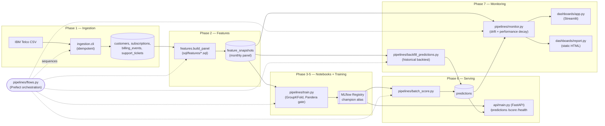

# Churn Prediction System

End-to-end, production-style customer churn prediction system built on
the IBM Telco Customer Churn dataset: Postgres → idempotent ingestion →
SQL feature extraction → notebook experimentation → training pipeline →
serving API → monitoring.

**This is a synthetic-data demo.** The source dataset is a static,
cross-sectional snapshot (one row per customer). Everything with a date
on it — `signup_date`, `billing_events`, `support_tickets`, the monthly
scoring panel — is generated by a seeded, documented synthetic layer, not
real telecom event data. See [DECISIONS.md](DECISIONS.md) for exactly how
and why.

Full build plan and phase status: [PLAN.md](PLAN.md).
Every non-obvious judgment call, with the alternative rejected and why:
[DECISIONS.md](DECISIONS.md).
Step-by-step commands to reproduce every phase from scratch:
[DEVELOPMENT.md](DEVELOPMENT.md).

## Quickstart

```bash
cp .env.example .env   # fill in real passwords
uv sync

docker compose up -d postgres pgadmin minio minio-init mlflow
uv run alembic upgrade head

uv run python -m churn.ingestion.cli
uv run python -m churn.features.build_panel
uv run pytest

uv run python pipelines/train.py   # trains + registers the champion model (Phase 5)
uv run python pipelines/batch_score.py            # scores the current cohort (Phase 6)
uv run uvicorn api.main:app --host 0.0.0.0 --port 8000   # serves predictions (Phase 6)
uv run python pipelines/backfill_predictions.py    # backtests every historical cohort (Phase 7)
uv run python pipelines/monitor.py                 # logs drift + performance-decay checks (Phase 7)
uv run streamlit run dashboards/app.py             # interactive monitoring dashboard (Phase 7)

# or run the whole thing above as one orchestrated flow:
uv run python pipelines/flows.py
```

Equivalent `make` targets exist (`make setup`, `make db-up`, `make ingest`,
`make test`, ...) — see the [Makefile](Makefile). `make` is not
preinstalled on Windows; the commands above are exactly what each target
runs.

Services once `db-up` has run:

| Service | URL |
|---|---|
| Postgres | `localhost:5432` |
| pgAdmin | http://localhost:5050 |
| MinIO console | http://localhost:9001 |
| MLflow | http://localhost:5000 |
| Inference API (once `make serve`/uvicorn is running) | http://localhost:8000 |
| Monitoring dashboard (once `make dashboard`/streamlit is running) | http://localhost:8501 |

## Status

All 8 phases complete, all verified end-to-end against real containers
and real notebook/pipeline execution, not just written:

- **Phase 1** (infra + DB + ingestion): 7,043 customers loaded, zero
  orphaned foreign keys, idempotent re-run confirmed. See
  [DECISIONS.md](DECISIONS.md#infra-issues-hit-during-verification) for
  the real infra issues hit and fixed along the way.
- **Phase 2** (SQL features + validation): full 18-month panel
  materialized (87,517 rows), every validation query clean, an
  adversarial point-in-time reconciliation check found zero mismatches,
  and the monthly churn rate came out at 1.27%–2.02% — confirming the
  imbalance the panel design predicted (see
  [DECISIONS.md](DECISIONS.md#imbalance-is-designed-in)), with one
  genuine caveat found and documented (the last cohort's structurally
  zero positive rate).
- **Phase 3** (notebooks: data audit, EDA, feature selection): the
  synthetic generator's statistical assumptions (payment-failure rates,
  the pre-churn ticket-velocity spike) confirmed empirically against the
  loaded data, not just trusted from the code; a second, independent
  leakage audit (0 mismatches across 80,968 tenure-trajectory checks);
  mutual information / permutation importance / a hand-rolled Boruta
  procedure / correlation pruning narrowed 44 candidate features to 12
  (see [PLAN.md](PLAN.md#phase-3--notebooks-0103--done)), written to
  `config/selected_features_v1.yaml` for Phase 5.
- **Phase 4** (notebooks: modelling, evaluation, business impact): an
  honest result reported as found, not smoothed over — plain
  `LogisticRegression(class_weight="balanced")` beat every
  `HistGradientBoostingClassifier` variant tried, tuned or not (test
  PR-AUC 0.1093 vs. 0.0593); top-decile lift of 4.5x confirms the ranking
  is real regardless. A cost-based threshold built from the actual
  retention economics in `config/config.yaml` found the *configured*
  risk bands would lose money on a real campaign, and a concretely-sized
  A/B test design shows the safe operating threshold only flags ~16
  customers/month — a real deployment constraint, not glossed over. See
  [PLAN.md](PLAN.md#phase-4--notebooks-0406--done) for the full numbers.
- **Phase 5** (training pipeline + registry): `pipelines/train.py` trains
  and registers the model type Phase 4's evidence actually supports
  (`LogisticRegression`, not the originally-planned GBM), gated by data
  validation (Pandera) and a model-promotion gate against the MLflow
  registry's current champion. Run twice against the real Postgres +
  MLflow server to prove the gate works, not just the training: the
  first run bootstrapped the champion (test PR-AUC 0.1093, matching
  Notebook 05 exactly); the second, identical run correctly was **not**
  promoted since it only tied the champion rather than beating it by
  `promotion_epsilon`. See
  [PLAN.md](PLAN.md#phase-5--training-pipeline--registry--done) for the
  full verification.
- **Phase 6** (inference API + batch scoring): `pipelines/batch_score.py`
  scores the real current cohort (5,174 customers) and idempotently
  upserts risk band + top-3 SHAP features into `predictions`; `api/`
  (FastAPI) serves those predictions plus an on-demand single-customer
  rescore, with Prometheus metrics, request-ID correlation, and graceful
  degradation (verified live by stopping Postgres mid-request — `/health`
  correctly returned 503 rather than crashing or hanging, the latter
  only true after a real connect-timeout bug this same test exposed was
  fixed). See
  [PLAN.md](PLAN.md#phase-6--inference-api--batch-scoring--done) for the
  full verification, including a required registry re-promotion this
  phase needed and documented rather than glossed over. Independently
  reviewed post-hoc before Phase 7: found and fixed one real blocker
  (`shap_top3` named one-hot dummy columns individually, reading as
  contradictory nonsense for the exact field Phase 7's dashboard will
  show) plus eight further real issues, all verified live — see
  [PLAN.md](PLAN.md#phase-6--inference-api--batch-scoring--done) and
  [DECISIONS.md](DECISIONS.md#shap-values-must-aggregate-to-source-feature-not-stay-one-hot-column-per-entry).
- **Phase 7** (monitoring + dashboard): `pipelines/backfill_predictions.py`
  backtests every historical cohort (82,343 rows, 17 months) with the
  current champion, giving `src/churn/monitoring/performance.py`
  something real to report — a genuine, honestly-labeled
  train/validation/test performance trend, not a single number
  (held-out test-cohort PR-AUC 0.11–0.12, correctly lower than the
  in-sample training cohorts' 0.09–0.20). `src/churn/monitoring/drift.py`
  (PSI/KS/KL) found a real, moderate drift signal on `tenure_months`
  (PSI 0.1881, comparing against train+val — the window the champion was
  actually fit on) between the training window and the live cohort —
  every other feature stayed stable. `pipelines/flows.py` orchestrates
  the whole pipeline (ingest → build panel → train → batch score →
  backfill → monitor) as one Prefect flow, run end to end for real:
  ingestion/panel-building correctly no-op'd (already up to date), a new
  training run correctly tied the champion and was **not** promoted, and
  every downstream stage correctly kept using the untouched champion.
  `dashboards/app.py` (Streamlit) and `dashboards/report.py` (static
  HTML) render the same monitoring computations interactively/for
  sharing — the Streamlit app verified headlessly with
  `streamlit.testing.v1.AppTest` (zero exceptions), not just a `curl`
  against the running process. Independently reviewed post-hoc before
  Phase 8: found and fixed a real drift-detection blind spot (quantile
  binning silently zeroed out PSI on a low-cardinality selected feature;
  `frequency_charges_90d`'s PSI went from 0.0014 to a real 0.051 once
  fixed) plus several further real issues, all verified live — see
  [PLAN.md](PLAN.md#phase-7--monitoring--dashboard--done) and
  [DECISIONS.md](DECISIONS.md#drift-binning-must-fall-back-to-exact-values-for-low-cardinality-features).
- **Phase 8** (tests, CI, docs): test coverage on `src/` went from 78%
  to **88%** (target was >80%) by testing real, previously-untested
  logic (ingestion's download retry/fallback behavior, row-count
  validation, panel-build idempotency checks, and a direct regression
  test for Phase 7's `model_version`-filter bug) rather than mocking
  orchestration glue for a number. `.pre-commit-config.yaml` (ruff/
  black/mypy as local `uv run` hooks) and `.github/workflows/ci.yml`
  added — verifying the pre-commit config locally caught a real bug in
  itself before it was ever committed (an unscoped hook briefly
  reformatted two committed Alembic migration files; reverted
  immediately, then fixed by scoping every hook to this project's own
  documented lint paths). This README's Architecture, Design decisions,
  Known limitations, and Runbook sections below were written this
  phase, once there was a finished system to describe accurately. See
  [PLAN.md](PLAN.md#phase-8--tests-ci-docs--done) and
  [DECISIONS.md](DECISIONS.md#pre-commit-file-scope-found-and-fixed-a-real-bug-in-itself).

`ruff`, `black --check`, `mypy --strict` clean on `src`, `tests`,
`pipelines`, `api`, and `dashboards`; pre-commit installed and verified.
See [PLAN.md](PLAN.md) for the full phase breakdown, current test
counts, and what's next.

## Repository layout

```
config/       YAML business/pipeline config (no secrets — see .env.example)
sql/          ddl (generated from Alembic), features (extraction queries), validation (data-quality queries)
src/churn/    the package: config, db, ingestion, features, models (split/pipeline/registry/inference), monitoring (drift/performance)
alembic/      versioned schema migrations — the source of truth for the DB schema
tests/        unit/ (no Docker needed) and integration/ (testcontainers, needs Docker)
notebooks/    exploration only — nothing here is imported by src/
pipelines/    train.py (5), batch_score.py + backfill_predictions.py + monitor.py (6/7), flows.py (7, Prefect orchestration)
api/          FastAPI serving layer: predictions, on-demand scoring, health, metrics (Phase 6)
dashboards/   app.py (Streamlit) + report.py (static HTML, writes to reports/, gitignored) (Phase 7)
```

## Architecture



Every arrow above is a real, live-verified data flow (see PLAN.md's
per-phase "Verify" sections) — not an aspirational diagram drawn before
the code existed. `pipelines/flows.py` is the only piece that spans
every phase; every other box works standalone, exactly as its own
`uv run python <script>` entry point (see [DEVELOPMENT.md](DEVELOPMENT.md)).

## Design decisions, summarized

Every non-obvious call this project made, with the alternative rejected
and why, lives in [DECISIONS.md](DECISIONS.md) (organized by phase, in
the order made). A few that shaped the system most:

- **Synthetic temporal layer, not real telecom events.** The IBM Telco
  dataset is a single cross-sectional snapshot; `signup_date`,
  `billing_events`, `support_tickets`, and the monthly scoring panel are
  all generated by a seeded, documented process (DECISIONS.md's Phase 1
  section) so this project could demonstrate point-in-time-correct
  feature engineering and a real training/monitoring cadence without
  real customer data.
- **Hand-written, parameterized SQL for feature extraction, not an
  ORM query layer** — window-function-heavy point-in-time logic stays
  reviewable (DECISIONS.md#tech-stack).
- **The model type followed the evidence, not the original plan**:
  plain `LogisticRegression(class_weight="balanced")` beat every
  GBM variant tried, tuned or not — reported as found even though the
  Phase 0 plan assumed a GBM
  (DECISIONS.md#logistic-regression-beats-every-gbm-variant).
- **`GroupKFold(groups=customer_id)`, never plain K-fold** — this
  panel has the same customer at multiple adjacent `reference_date`s;
  a naive split leaks label information across folds.
- **MLflow's alias API (`champion`), not the deprecated stages API** —
  and a `save_model()`+`log_artifacts()` workaround for a real
  client/server version incompatibility discovered mid-build
  (DECISIONS.md#mlflow-client-3x-vs-server-2x-model-logging-incompatibility).
- **Batch-scored predictions served from Postgres, on-demand scoring
  only against already-materialized features** — never a live rerun of
  the window-function SQL per request
  (DECISIONS.md#precomputed-serving-plus-on-demand-rescore-hybrid).
- **Every historical cohort backtested, not just the current one** —
  the only way this synthetic world (with a frozen "today") can show a
  genuine multi-month performance trend, with every cohort honestly
  labeled in-sample or held-out
  (DECISIONS.md#backfill-predictions-scores-historical-cohorts-as-a-retrospective-backtest).
- **Three independent adversarial reviews** (Phases 4, 6, 7), each by a
  fresh agent with no prior context, each finding at least one real bug
  a self-review missed — see PLAN.md's "Independently reviewed
  post-hoc" bullets for what each one found and fixed.

## Known limitations

Honestly documented, not glossed over — most of these are already
flagged where they were found (DECISIONS.md/PLAN.md), collected here
for anyone deciding whether this system is ready for anything beyond a
demo:

- **This is a synthetic-data demo.** No real telecom customers or
  events are involved anywhere. See the top of this README and
  DECISIONS.md's Phase 1 section.
- **The champion's probabilities are not calibrated.**
  `class_weight="balanced"` training trades calibration for class
  separation — mean scored probability (~0.31) is far above the true
  ~1.6% base churn rate. Treat scores as a *ranking*, not a probability
  (DECISIONS.md's Phase 4 section; the dashboard/report both surface
  this caveat directly next to the numbers).
- **The configured `risk_bands` (0.3/0.7) need recalibrating before any
  real campaign** — Notebook 06's cost-based threshold analysis found
  the *configured* bands would lose money at this model's current
  precision; the actual business-optimal threshold came out far higher
  (~0.94), which only flags a handful of customers/month. A properly
  powered A/B test at that threshold would take on the order of 100+
  months to accumulate enough volume to validate causally (PLAN.md's
  Phase 4 section).
- **`GroupKFold` CV scores and forward-in-time test PR-AUC are not
  comparable** — never read one as a proxy for the other
  (DECISIONS.md#groupkfold-cv-score-is-not-comparable-to-forward-in-time-pr-auc).
- **KS-test p-values on this panel should be read as a rough signal,
  not a rigorous test** — cohorts share mostly the same customers a few
  months apart, violating the test's independence assumption
  (`churn.monitoring.drift.ks_statistic`'s docstring).
- **Drift binning still has a residual gap**: a numeric feature with
  *more* distinct values than `drift_bins` (10) that's also heavily
  skewed could still see its quantile edges bunch up, the same failure
  mode fixed for low-cardinality features in Phase 7's review — not
  currently true of any selected feature, but not structurally
  prevented either (DECISIONS.md#drift-binning-must-fall-back-to-exact-values-for-low-cardinality-features).
- **No persisted monitoring-run history** — every drift/performance
  number is recomputed live on each request; there's no time-series of
  past monitoring runs to chart trends *in the monitoring itself*
  without re-deriving them from `predictions`
  (DECISIONS.md#monitoring-results-are-computed-on-demand-not-persisted).
- **Single-machine, no-auth deployment.** `api/main.py` has no
  authentication, rate limiting, or TLS termination — fine for local
  `curl`/dashboard use, not for an internet-facing deployment as-is.
- **No git remote configured.** This has been a local-only repository
  throughout development; the GitHub Actions workflow in
  `.github/workflows/ci.yml` is ready but has never actually run in CI
  (only its equivalent commands, run locally).

## Runbook

Day-to-day operation, assuming `docker compose up -d postgres pgadmin
minio minio-init mlflow` is already running (see Quickstart above).

**Something isn't responding**
- Docker Desktop doesn't auto-start on a fresh boot on this machine —
  check `docker info`; if it fails, start Docker Desktop and retry.
- Check each service's health: `docker compose ps` (all four should say
  `healthy`/`Up`); Postgres on `:5432`, MLflow UI on `:5000`, MinIO
  console on `:9001`.
- API/dashboard depend on Postgres + MLflow being reachable — `curl
  localhost:8000/health` reports which dependency is down
  (`{"database": ..., "model": ...}`) rather than just failing silently.

**Retrain and (maybe) promote a new champion**
```bash
uv run python pipelines/train.py
```
Always registers a new version; only promotes to `champion` if its test
PR-AUC beats the current champion's by `config.yaml`'s
`promotion_epsilon` — an identical/worse run registers but doesn't
promote. Check what happened: `training_complete`'s logged `promoted`
field, or the MLflow UI's Registered Models page.

**Roll back a bad promotion**
```python
from mlflow.tracking import MlflowClient
client = MlflowClient()  # after mlflow.set_tracking_uri(...)
client.set_registered_model_alias("churn_classifier", "champion", "<previous_version>")
```
`api/main.py`'s `/score` endpoint picks this up automatically within one
request (it checks the alias on every call); `batch_score.py`/
`backfill_predictions.py` pick it up on their next run.

**Re-run one failed pipeline stage**
Every stage is independently runnable and (except `train.py`) safely
re-runnable — see [DEVELOPMENT.md](DEVELOPMENT.md) for the exact command
per phase. `pipelines/flows.py`'s Prefect flow halts on the first
failing stage (verified live — see DECISIONS.md's Phase 7 post-review
section) rather than continuing with stale state; re-run just the
failed stage's own script directly rather than the whole flow.

**Check current test/lint status**
```bash
uv run pytest              # 92+/92+, needs Docker for tests/integration/
uv run ruff check src tests pipelines api dashboards
uv run black --check src tests pipelines api dashboards
uv run mypy src pipelines api dashboards
```
or `make test` / `make lint` (see the [Makefile](Makefile)).

**Where the logs are**
Every script/service logs structured single-line JSON to stdout
(structlog → stdlib → JSON formatter, see CLAUDE.md's Conventions) — no
`print()` anywhere in `src/`. `pipelines/flows.py` relays each stage's
full stdout/stderr into Prefect's own run logger (visible via `prefect
server start` + the Prefect UI, or `prefect flow-run logs`, once a
Prefect server is running) in addition to the terminal.
